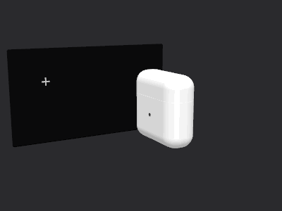
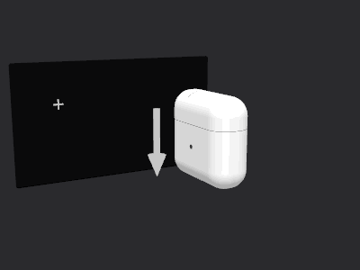
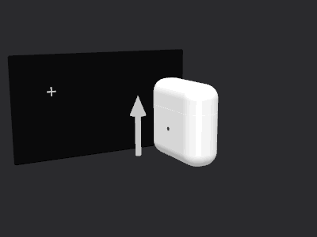
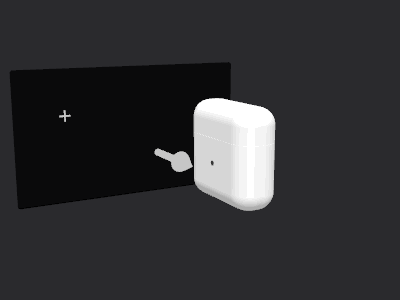
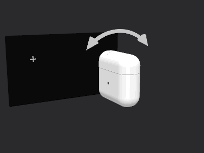
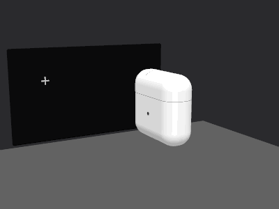
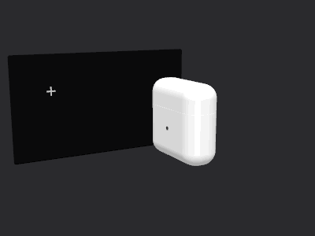

# MinePointer

Play Minecraft Java on a Mac with a closed AirPods case instead of a mouse.

MinePointer reads the motion sensors of the earbuds while they sit in the closed case and turns it into mouse input: slow rotation of the case moves the camera, sharp gestures press the mouse buttons and turn the wheel. The keyboard stays as it is.

The sensor stream comes from [AirPointer](https://github.com/oscarcreatess/airpointer) (MIT). This repository is AirPointer's history with MinePointer added on top. MinePointer adds the camera, the gesture detector, calibration and mouse output.

> [!WARNING]
> This is an experimental personal project. It uses private macOS Bluetooth APIs through AirPointer's helper, and a session has side effects on the AirPods (audio and microphone are moved off them, and on some models case data and connection settings change). Read AirPointer's [Before you use it](https://github.com/oscarcreatess/airpointer#before-you-use-it) first.

## Status

Tested on one setup only: AirPods 4 with ANC, macOS 27.2.1, Apple Silicon, Minecraft Java 26.3 in fullscreen. Other AirPods models that AirPointer recognises may work but have not been tried, except AirPods Pro 1, which MinePointer does not support.

## Controls

Hold the closed case in your right hand: lid on top, the back in your palm, the front with the status light to the left. Every gesture starts from a short calm hold. The animations run at real speed: a jerk takes about a tenth of a second.

| Motion | Action | How |
|---|---|---|
| Slow rotation | Camera |  |
| Sharp jerk down | Left click |  |
| Shake | Hold left button |  |
| Sharp jerk up | Right click (or release the bow while the right button is latched) |  |
| Pull toward you | Latch the right button |  |
| Twist | Mouse wheel, one step per twist |  |
| Case flat and still | Pause |  |
| <kbd>⌃⌥Space</kbd> | Panic: release all buttons and stop output | |
| <kbd>⌃⌥C</kbd> | Recalibrate | |

At start, MinePointer calibrates the grip: hold the case still, then twist it clockwise three times, then tilt it slowly. The steps show in the MinePointer window, with an animation of the case, and in the on-screen indicator if you turn it on.

The AirPods firmware ends the stream after about 30 minutes. Open and close the case lid to start a new session; MinePointer reconnects on its own.



## Install

1. Download `MinePointer-<version>.dmg` (or build it, see below), open it and drag MinePointer to Applications.
2. Open MinePointer. The DMG is signed but not notarized, so macOS blocks the first launch: open System Settings → Privacy & Security, scroll to the message about MinePointer and click **Open Anyway**. This is needed once.
3. The setup window walks you through the rest: Bluetooth and Accessibility permissions (Input Monitoring is optional), choosing your AirPods, connecting the case, the grip calibration and a short gesture check. MinePointer does not move the cursor or click during setup.

MinePointer then lives in the menu bar: start and stop, recalibrate, output on and off, the on-screen indicator, the Sandbox (a model of the case that follows yours, with the gestures it recognizes and nothing clicked), Settings (camera speed, Minecraft sensitivity, gesture thresholds, scroll direction, launch at login, app icon) and the logs folder.

Requirements: macOS 14 or later on Apple Silicon, AirPods paired with the Mac, Minecraft Java Edition.

Close keyboard-layout switchers that use event taps while playing: they can swallow key-ups and leave movement keys stuck.

### Uninstall

Quit MinePointer from its menu, delete it from Applications, then remove its data and permissions:

```sh
rm -rf ~/Library/Application\ Support/MinePointer ~/Library/Logs/MinePointer
tccutil reset All io.github.rymqan.MinePointer
```

AirPointer's helper keeps the chosen AirPods and its own state in `~/Library/Application Support/AirPointer/`, shared with AirPointer itself. Delete that folder too unless you also use AirPointer.

## Build

Requirements: Xcode command line tools.

```sh
git clone https://github.com/rymqan/MinePointer.git
cd MinePointer
./build-minepointer.sh        # build/MinePointer.app, signed, plus the offline self-test
./package-minepointer.sh      # build/MinePointer-<version>.dmg, with signature and bundle checks
```

Both sign with the "Apple Development" identity by default; a stable identity keeps the permissions across builds. `MINEPOINTER_SIGNING_IDENTITY=-` signs ad hoc (macOS then asks for the permissions again after every build). With a Developer ID identity and `MINEPOINTER_NOTARY_PROFILE=<notarytool keychain profile>`, `package-minepointer.sh` also notarizes and staples the DMG. The version is in `Packaging/VERSION`.

## How it works

One app, two processes. `MinePointer` is the menu bar app (AppKit). It runs `MinePointer --engine` as a child: the camera, gesture detector and mouse output, at 240 Hz on a plain run loop. The engine is not an app on purpose: macOS wakes a background app only every ~100 ms while a fullscreen game is in front, which makes the camera choppy. The two talk in lines over the engine's stdin and stdout (`Sources/MinePointer/EngineLink.swift`); the engine releases every mouse button and quits when the app goes away, and the app releases the buttons if the engine crashes.

Files:

- Settings: `~/Library/Application Support/MinePointer/config.json`. Every tunable is a snake_case key; missing keys fall back to the defaults in `Sources/MinePointer/Types.swift`, and changes apply while playing. The calibration rewrites `neutral_up` and `forward_axis` at every start. `mc_sensitivity` must match Minecraft's mouse sensitivity slider (60% = 0.3).
- Logs: `~/Library/Logs/MinePointer/` (`engine.log`; raw sensor recordings `helper-*.txt` only with `"record_sessions": true`).

## Development

- `MINEPOINTER_DIR=<folder>` puts the config at `<folder>/config.json` and the logs in `<folder>/logs`, e.g. the repository itself for the recording and replay tools.
- `build/MinePointer.app/Contents/MacOS/MinePointer --engine` runs the engine alone in a terminal (commands on stdin: `recalibrate`, `output on`, `output off`, `quit`).
- `MINEPOINTER_ENGINE=tools/fake-engine.py` runs the app against a scripted fake engine; `MINEPOINTER_SETUP_STEP=<1-7>` opens the setup at a step.
- `--self-test` runs the offline checks.
- `tools/render-gestures.sh` re-renders the gesture animations in `media/gestures/` from the clips in `Sources/MinePointer/CaseMotion.swift`; the app plays the same clips in setup. The self-test runs every clip through the detector and the calibration, so an animation cannot drift away from what MinePointer recognizes.
- `--replay [take ...]` replays recorded sessions from `logs/` through the camera and gesture detector.
- `--calibrate-log logs/helper-XXXX.txt` runs the calibration on a recorded log.
- `MINEPOINTER_TRACE=1` (e.g. `open --env MINEPOINTER_TRACE=1 /Applications/MinePointer.app`) writes a debugging trace to `output-*.csv` in the logs folder: posted mouse moves and button events, the system-wide key presses (key codes, in every app), frontmost-app changes and timing notes. Do not share a trace you would not share as a keylog.

## Repository layout

This repository is a fork of AirPointer: its files stay where upstream keeps them, and MinePointer adds its own.

| Path | Contents |
|---|---|
| `Sources/MinePointer` | MinePointer: the engine, and the app in `App/` |
| `build-minepointer.sh`, `package-minepointer.sh`, `Packaging/` | Build, DMG, version, and the icons (SVG sources in `Packaging/Icon/`, built by `make-icon.swift`) |
| `tools/` | MinePointer's recording, log and animation tools |
| `media/` | README animations, rendered by `tools/render-gestures.sh` |
| `Sources/AirPointer`, `Sources/ClosedCase*` | AirPointer; MinePointer compiles its helpers, `ClosedCaseAirPods.swift`, `RemoteKit.swift` and `AccessibilityGuide.swift` |
| `Assets/`, `Docs/`, `Scripts/`, `Tests/`, `build.sh` | AirPointer, unused by MinePointer |

Apart from this README, `LICENSE` and `.gitignore`, AirPointer's files are unmodified; AirPointer's own README is [upstream](https://github.com/oscarcreatess/airpointer).

### Updating AirPointer

MinePointer's commits stay on top of AirPointer's history:

```sh
git remote add upstream https://github.com/oscarcreatess/airpointer.git   # once
git fetch upstream
git rebase upstream/main
git push --force-with-lease
```

If the rebase stops on `README.md`, keep this README (`git checkout --theirs README.md`, since during a rebase "theirs" is MinePointer's commit). Then run `./build-minepointer.sh` and update the commit in [THIRD_PARTY_NOTICES.md](THIRD_PARTY_NOTICES.md).

## License

MinePointer is released under the [MIT License](LICENSE). AirPointer and the other third-party parts keep their own licenses; see [THIRD_PARTY_NOTICES.md](THIRD_PARTY_NOTICES.md).

MinePointer is not affiliated with Apple, Mojang or Microsoft, or with the authors of AirPointer.
